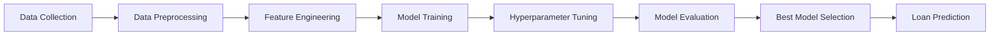

# Technical Data Summary — Loan Approval Prediction System

> **Project**: Loan Approval Prediction Using Ensemble Learning
> **Type**: Machine Learning Academic Project (Semester 4)
> **Classification**: Binary Classification (Approved / Rejected)

---

## 1. Dataset Features (Input Variables)

The system models a loan application with **11 input features** spanning four categories. The data schema is based on the classic [Analytics Vidhya Loan Prediction](https://datahack.analyticsvidhya.com/contest/practice-problem-loan-prediction-iii/) dataset.

### 1.1 Feature Schema

| # | Feature Name | Data Type | Possible Values | Category |
|---|---|---|---|---|
| 1 | **Gender** | Categorical (binary) | `Male`, `Female` | Personal |
| 2 | **Married** | Categorical (binary) | `Yes`, `No` | Personal |
| 3 | **Dependents** | Categorical (ordinal) | `0`, `1`, `2`, `3+` | Personal |
| 4 | **Education** | Categorical (binary) | `Graduate`, `Not Graduate` | Personal |
| 5 | **Self_Employed** | Categorical (binary) | `Yes`, `No` | Employment |
| 6 | **ApplicantIncome** | Numerical (continuous) | Positive integer (₹ monthly) | Employment |
| 7 | **CoapplicantIncome** | Numerical (continuous) | Non-negative integer (₹ monthly) | Employment |
| 8 | **LoanAmount** | Numerical (continuous) | Positive integer (in thousands ₹) | Loan |
| 9 | **Loan_Amount_Term** | Numerical (discrete) | `12`, `36`, `60`, `84`, `120`, `180`, `240`, `300`, `360`, `480` (days) | Loan |
| 10 | **Credit_History** | Binary | `0` (Poor), `1` (Good) | Credit |
| 11 | **Property_Area** | Categorical (nominal) | `Urban`, `Semiurban`, `Rural` | Property |

### 1.2 Target Variable

| Variable | Type | Values |
|---|---|---|
| **Loan_Status** | Binary categorical | `Approved`, `Rejected` |

### 1.3 Feature Breakdown by Type

| Type | Count | Features |
|---|---|---|
| **Categorical (binary)** | 4 | Gender, Married, Education, Self_Employed |
| **Categorical (ordinal)** | 1 | Dependents |
| **Categorical (nominal)** | 1 | Property_Area |
| **Numerical (continuous)** | 3 | ApplicantIncome, CoapplicantIncome, LoanAmount |
| **Numerical (discrete)** | 1 | Loan_Amount_Term |
| **Binary integer** | 1 | Credit_History |

---

## 2. Machine Learning Models

The system employs an **ensemble learning** approach using three tree-based algorithms:

### 2.1 Model Descriptions

| Model | Algorithm Family | Key Technique |
|---|---|---|
| **Random Forest** | Bagging ensemble | Bootstrap aggregation + feature randomization across decision trees |
| **XGBoost** | Gradient boosting | Sequential tree building with L1/L2 regularization |
| **LightGBM** | Gradient boosting | Histogram-based splitting with leaf-wise tree growth |

### 2.2 Model Performance Metrics (Mock/Demo Data)

> [!NOTE]
> The metrics below are **demonstration values** used for UI preview. They will be replaced with actual metrics from trained models once the ML backend is connected.

| Model | Accuracy | Precision | Recall | F1 Score | ROC-AUC |
|---|---|---|---|---|---|
| **Random Forest** | 82.0% | 80.0% | 88.0% | 84.0% | 81.0% |
| **XGBoost** | 84.0% | 83.0% | 89.0% | 86.0% | 83.0% |
| **LightGBM** | **85.0%** | **84.0%** | **90.0%** | **87.0%** | **84.0%** |

> **Best performing model**: LightGBM (highest across all metrics)

### 2.3 Evaluation Metrics Definitions

| Metric | Description |
|---|---|
| **Accuracy** | Overall correctness of predictions (TP+TN / Total) |
| **Precision** | Ratio of true positives among all predicted positives |
| **Recall** | Ability to correctly identify all actual positives (sensitivity) |
| **F1 Score** | Harmonic mean of Precision and Recall |
| **ROC-AUC** | Area under the Receiver Operating Characteristic curve — model discrimination capability |
| **Confusion Matrix** | Classification breakdown table (TP, FP, TN, FN) |

---

## 3. Feature Importance Data (Per Model)

Feature importance values indicate each variable's relative contribution to the model's prediction. Higher values = stronger influence.

> [!NOTE]
> These are demonstration values. Actual importance values are computed from trained models via the backend.

### 3.1 Random Forest

| Rank | Feature | Importance |
|---|---|---|
| 1 | Credit History | 28.0% |
| 2 | Applicant Income | 19.0% |
| 3 | Loan Amount | 15.0% |
| 4 | Coapplicant Income | 10.0% |
| 5 | Education | 8.0% |
| 6 | Property Area | 7.0% |
| 7 | Loan Amount Term | 5.0% |
| 8 | Dependents | 3.0% |
| 9 | Self Employment | 3.0% |
| 10 | Married | 1.0% |
| 11 | Gender | 1.0% |

### 3.2 XGBoost

| Rank | Feature | Importance |
|---|---|---|
| 1 | Credit History | 31.0% |
| 2 | Applicant Income | 21.0% |
| 3 | Loan Amount | 14.0% |
| 4 | Education | 9.0% |
| 5 | Property Area | 8.0% |
| 6 | Coapplicant Income | 6.0% |
| 7 | Loan Amount Term | 4.0% |
| 8 | Married | 3.0% |
| 9 | Dependents | 2.0% |
| 10 | Self Employment | 1.0% |
| 11 | Gender | 1.0% |

### 3.3 LightGBM

| Rank | Feature | Importance |
|---|---|---|
| 1 | Credit History | 33.0% |
| 2 | Applicant Income | 22.0% |
| 3 | Loan Amount | 13.0% |
| 4 | Property Area | 9.0% |
| 5 | Education | 7.0% |
| 6 | Coapplicant Income | 5.0% |
| 7 | Loan Amount Term | 4.0% |
| 8 | Married | 3.0% |
| 9 | Dependents | 2.0% |
| 10 | Self Employment | 1.0% |
| 11 | Gender | 1.0% |

### 3.4 Cross-Model Feature Importance Summary

All three models consistently rank the same top-3 features:

| Rank | Feature | RF | XGBoost | LightGBM | Avg |
|---|---|---|---|---|---|
| 1 | **Credit History** | 28% | 31% | 33% | **30.7%** |
| 2 | **Applicant Income** | 19% | 21% | 22% | **20.7%** |
| 3 | **Loan Amount** | 15% | 14% | 13% | **14.0%** |

> [!IMPORTANT]
> **Credit History** is overwhelmingly the most influential predictor across all models, followed by **Applicant Income** and **Loan Amount**. Gender and Married status have negligible impact (≤1%).

---

## 4. Mock Prediction Records (Sample Data)

The system ships with **8 sample prediction records** for UI demonstration:

| ID | Date | Gender | Married | Deps | Education | Self-Emp | Applicant Inc | Co-App Inc | Loan Amt | Term | Credit Hist | Area | Prediction | Confidence | Model |
|---|---|---|---|---|---|---|---|---|---|---|---|---|---|---|---|
| LP-2024-001 | 2024-03-15 | Male | Yes | 1 | Graduate | No | ₹55,000 | ₹12,000 | 200K | 360 | Good | Urban | ✅ Approved | 91.2% | LightGBM |
| LP-2024-002 | 2024-03-14 | Female | No | 0 | Graduate | No | ₹38,000 | ₹0 | 150K | 360 | Good | Semiurban | ✅ Approved | 84.7% | XGBoost |
| LP-2024-003 | 2024-03-14 | Male | Yes | 2 | Not Grad | Yes | ₹22,000 | ₹5,000 | 180K | 360 | Poor | Rural | ❌ Rejected | 78.3% | LightGBM |
| LP-2024-004 | 2024-03-13 | Male | Yes | 0 | Graduate | No | ₹72,000 | ₹25,000 | 350K | 180 | Good | Urban | ✅ Approved | 93.4% | Random Forest |
| LP-2024-005 | 2024-03-13 | Female | No | 0 | Not Grad | No | ₹18,000 | ₹0 | 100K | 360 | Poor | Rural | ❌ Rejected | 89.1% | XGBoost |
| LP-2024-006 | 2024-03-12 | Male | Yes | 3+ | Graduate | Yes | ₹95,000 | ₹30,000 | 500K | 360 | Good | Semiurban | ✅ Approved | 87.6% | LightGBM |
| LP-2024-007 | 2024-03-12 | Female | Yes | 1 | Graduate | No | ₹42,000 | ₹8,000 | 120K | 360 | Good | Urban | ✅ Approved | 90.5% | Random Forest |
| LP-2024-008 | 2024-03-11 | Male | No | 0 | Not Grad | Yes | ₹15,000 | ₹0 | 80K | 180 | Poor | Rural | ❌ Rejected | 92.3% | LightGBM |

**Distribution**: 5 Approved (62.5%) / 3 Rejected (37.5%)

### Dashboard Aggregate Stats (Mock)

| Metric | Value |
|---|---|
| Total Applications | 1,248 |
| Approved | 846 (67.8%) |
| Rejected | 402 (32.2%) |
| Best Model | LightGBM |

---

## 5. API Architecture

### 5.1 Backend Endpoints

The frontend is designed to connect to a Python ML backend via REST API:

| Endpoint | Method | Description |
|---|---|---|
| `POST /api/predict` | POST | Submit a loan application for ML prediction |
| `GET /api/models/metrics` | GET | Retrieve performance metrics for all models |
| `GET /api/models/features` | GET | Retrieve feature importance data for all models |

### 5.2 API Configuration

| Setting | Value |
|---|---|
| Base URL (default) | `http://localhost:5000` |
| Config Source | `VITE_API_URL` environment variable |
| Mock Data Fallback | Automatic when `VITE_API_URL` is not set |

### 5.3 Prediction Request/Response Schema

**Request Body** (`POST /api/predict`):
```json
{
  "Gender": "Male",
  "Married": "Yes",
  "Dependents": "1",
  "Education": "Graduate",
  "Self_Employed": "No",
  "ApplicantIncome": 55000,
  "CoapplicantIncome": 12000,
  "LoanAmount": 200,
  "Loan_Amount_Term": 360,
  "Credit_History": 1,
  "Property_Area": "Urban"
}
```

**Response Body**:
```json
{
  "prediction": "Approved",
  "confidence": 0.912,
  "model": "LightGBM",
  "feature_importance": [
    { "feature": "Credit History", "importance": 0.33 },
    { "feature": "Applicant Income", "importance": 0.22 },
    ...
  ]
}
```

### 5.4 Mock Prediction Logic

When no backend is connected, the frontend uses a simple heuristic to generate demo predictions:

```
isLikelyApproved = (Credit_History === 1) AND (ApplicantIncome > 20000)
```

- **Approved**: confidence range `0.75 – 0.95`
- **Rejected**: confidence range `0.65 – 0.90`
- Model is randomly selected from the three available models

> [!WARNING]
> This is **NOT** machine learning logic. It is solely for generating varied mock data in the frontend demo.

---

## 6. Data Persistence

| Mechanism | Storage | Key | Purpose |
|---|---|---|---|
| Prediction History | `localStorage` | `loan-predict-history` | Persists user predictions across browser sessions |
| Initial Data | Mock data in source code | — | Pre-populated on first load if no localStorage data exists |

---

## 7. Technology Stack

### 7.1 Frontend

| Technology | Version | Purpose |
|---|---|---|
| **React** | ^19.3.0 | UI framework |
| **TypeScript** | ~6.0.2 | Type-safe JavaScript |
| **Vite** | ^8.3.0 | Build tool & dev server |
| **Tailwind CSS** | ^4.3.3 | Utility-first CSS framework |
| **React Router DOM** | ^7.18.3 | Client-side routing |
| **Recharts** | ^3.10.1 | Data visualization (charts) |
| **Radix UI** | Various | Accessible UI primitives (Dialog, Select, Toast, Tooltip, etc.) |
| **Lucide React** | ^1.44.0 | Icon library |
| **class-variance-authority** | ^0.7.1 | Component variant management |
| **clsx** + **tailwind-merge** | ^2.1.1 / ^3.6.0 | Conditional CSS class utilities |

### 7.2 ML & Data (Backend — Planned)

| Technology | Purpose |
|---|---|
| **Python** | Core ML language |
| **Pandas** | Data manipulation & preprocessing |
| **NumPy** | Numerical computations |
| **Scikit-learn** | Random Forest, preprocessing, evaluation |
| **XGBoost** | XGBoost model implementation |
| **LightGBM** | LightGBM model implementation |
| **Matplotlib** | Static visualizations |
| **Seaborn** | Statistical visualizations |

---

## 8. ML Pipeline Workflow



| Step | Description |
|---|---|
| 1. Data Collection | Historical loan application data acquisition |
| 2. Data Preprocessing | Cleaning, handling missing values, encoding categoricals |
| 3. Feature Engineering | Variable selection, creation of derived features |
| 4. Model Training | Training RF, XGBoost, and LightGBM classifiers |
| 5. Hyperparameter Tuning | Grid search / Random search optimization |
| 6. Model Evaluation | Cross-validation with Accuracy, Precision, Recall, F1, ROC-AUC |
| 7. Best Model Selection | Comparative performance analysis |
| 8. Loan Prediction | Real-time inference on new applications |

---

## 9. Application Pages & Data Flow

| Route | Page | Data Consumed |
|---|---|---|
| `/dashboard` | Dashboard | `mockDashboardStats`, `mockModelMetrics`, prediction history |
| `/prediction` | Prediction Form | User input → `LoanApplication` type |
| `/result` | Result Display | `PredictionResponse` from prediction service |
| `/models` | Model Comparison | `mockModelMetrics` (3 models × 5 metrics) |
| `/features` | Feature Importance | `mockFeatureImportance` (3 models × 11 features) |
| `/history` | Prediction History | `PredictionRecord[]` from `localStorage` |
| `/about` | About | Static content (models, workflow, tech stack) |

---

## 10. Key Type Definitions

Source: [`src/types/index.ts`](file:///e:/YEAR%202/SEM%204/ML/Loan-Approval-Prediction/src/types/index.ts)

| Type | Description |
|---|---|
| `LoanApplication` | 11-field input schema for a loan application |
| `PredictionOutcome` | `'Approved' \| 'Rejected'` |
| `ModelName` | `'Random Forest' \| 'XGBoost' \| 'LightGBM'` |
| `FeatureImportance` | `{ feature: string, importance: number }` |
| `PredictionResponse` | Prediction result with confidence, model name, and feature importance |
| `PredictionRecord` | Full record: ID + date + application + result |
| `ModelMetrics` | Performance metrics (accuracy, precision, recall, F1, ROC-AUC) per model |
| `FeatureImportanceByModel` | Feature importance array grouped by model |
| `DashboardStats` | Aggregate statistics (total, approved, rejected, best model) |
| `InfluenceLevel` | `'High' \| 'Medium' \| 'Low'` |
| `PredictionExplanation` | Per-feature influence explanation |
